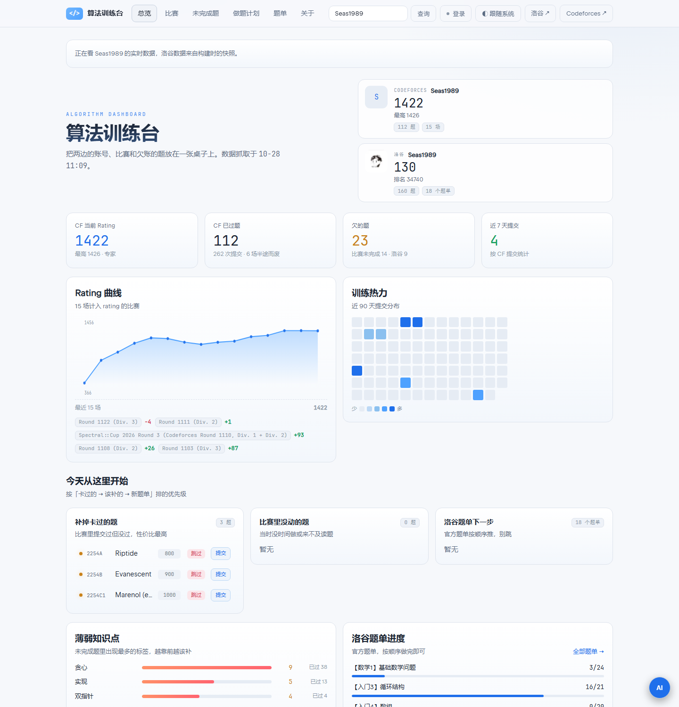
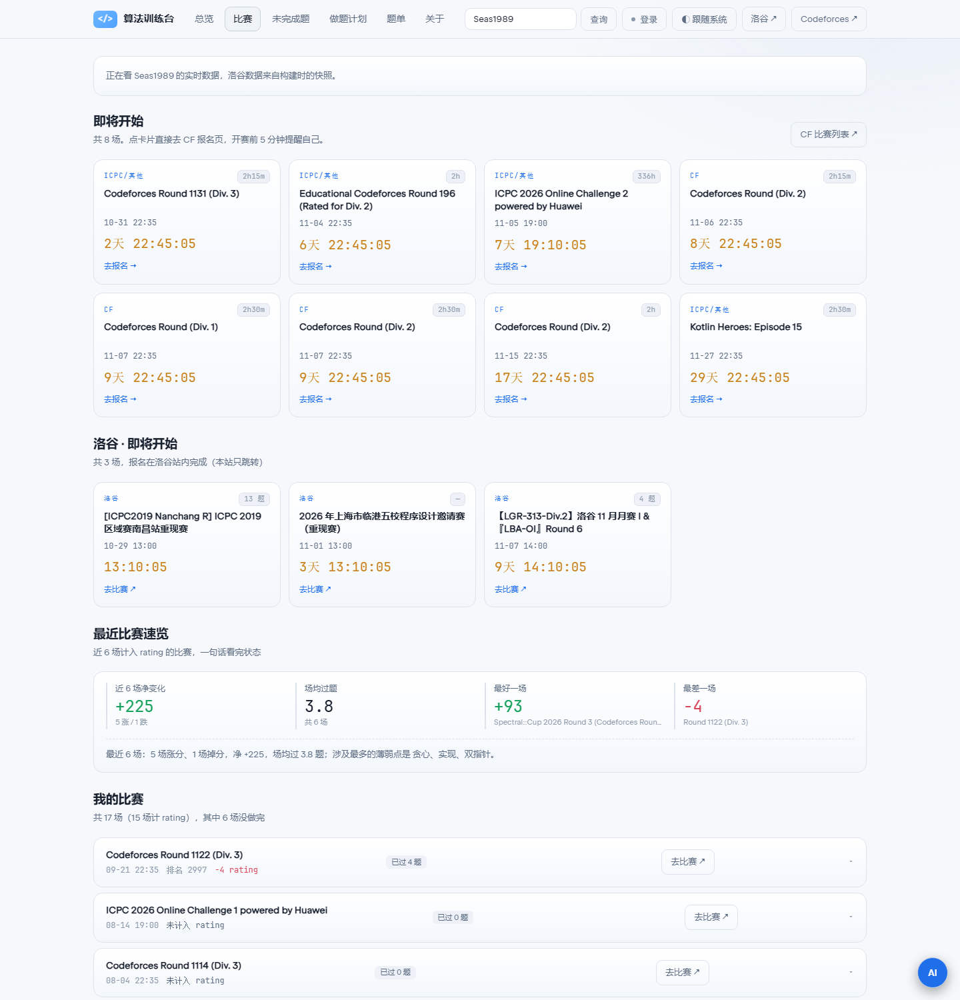

# 算法训练台 · Algo Desk

[](https://github.com/Seas1989/algo-desk/actions/workflows/deploy.yml)

线上地址：<https://seas1989.github.io/algo-desk/>

把 **Codeforces** 和 **洛谷** 的账号、比赛、没补完的题放到同一张桌子上——一个纯静态站点。

不用在 OJ 里翻提交记录，也不用靠记忆找「哪场比赛做了一半」：打开就能看到还欠哪些题、下一场什么时候开、最近几场在涨还是在掉。



## 六个页面各解决什么

**总览**
双平台 rating、过题数与欠账统计，rating 曲线，近 90 天提交热力，当天建议（卡过的题 / 没动的题 / 题单下一步），薄弱算法标签，洛谷难度分布与洛谷比赛记录。
你会看到：一句话的当前状态，和最该先补的三件事。

**比赛**
即将开始的场次带秒级倒计时（CF 与洛谷各一组），点卡片直达比赛页；「我的比赛」逐场列出题目状态（通过 / 提交过但没过 / 没动），半途而废的场次标红；「我的洛谷比赛」列出洛谷 rating 记录；顶部有近 6 场速览。
你会看到：下一场倒计时，以及哪些比赛打穿了、哪些烂尾了。

**未完成题**
三个来源分开统计：比赛未完成、题库练习未过、洛谷未通过，可按难度区间、算法标签、关键字筛选。
你会看到：一份能直接照着补的欠账清单。

**做题计划**
从两边欠账自动生成的一周清单：每天 3 题，卡过的优先、薄弱标签加权、难度爬坡。完成/跳过只存本机；跳过会自动补一道同标签、难度接近的题；也可粘贴洛谷导出的计划 JSON 替换。
你会看到：今天该做哪三道题，和本周进度、连续打卡。

**题单**
CF 按难度分档、CF 按算法分组、洛谷官方题单完成进度，全部来自你实际没过的题。
你会看到：按顺序能一路做下去的题列表。

**关于**
数据从哪来、怎么更新、免责声明。



## 每一行都通向提交

题目行与「提交」按钮是并列的原生链接：点行进题面，点「提交」直达提交表单（CF `/contest/{id}/submit`，gym 走 `/gym/{id}/submit`，洛谷题目页自带提交框）。用 `Ctrl` / 中键点击能各自开新标签。

## AI 教练（BYOK）

右下角「AI」按钮打开抽屉：自带 API Key（DeepSeek / 硅基流动 / 通义 / 智谱 / OpenRouter / 自定义），浏览器直连 OpenAI 兼容接口。请求只携带≤800 字公开统计摘要（题号题名、标签、比赛名），Key 和数据都留在本机 `localStorage`，不经任何第三方。顶栏 handle 输入框可实时查任意 CF 用户（直连 CF API，`?cf=xxx` 可分享）。

## 快速开始

需要 Node 18 以上。

```bash
npm install
npm run fetch     # 抓取 CF + 洛谷，写入 public/data/*.json
npm run dev       # 本地预览
npm run build     # 产出 dist/
```

`npm run fetch:refresh` 忽略缓存强制重抓。

换账号：编辑 `scripts/fetch-data.mjs` 顶部的 `CF_HANDLE` / `LUOGU_UID`，或

```bash
node scripts/fetch-data.mjs --cf=你的handle --luogu=你的uid
```

## 数据从哪来

| 平台 | 方式 | 用到的接口 |
| --- | --- | --- |
| Codeforces | 官方 API | `user.info`、`user.rating`、`user.status`、`contest.list`、`problemset.problems` |
| 洛谷 | 公开页面 | 个人主页、练习情况、官方题单列表与详情、比赛列表 `/contest/list`，解析页面里的 `<script id="lentille-context">` |

只读公开数据，**不登录、不保存任何账号密码**。

两处实现细节：

- 洛谷有一条 `C3VK` 反爬 Cookie：脚本先发一次请求拿到 Cookie，再带着 Cookie 重试；所有请求做了限速与本地缓存（`.cache/`），`--refresh` 可强制重抓。
- 判断「是否参加过某场 CF 比赛」不能只看提交记录里有没有 `contestId`（在题库刷题也会带上它）。脚本用的是「有 rating 记录，**或** 提交时间落在该场比赛时段内」。

## 目录结构

```
scripts/fetch-data.mjs   抓取 + 聚合，产出三个 JSON
src/main.js              hash 路由、主题切换、handle 实时查、启动
src/views.js             页面渲染入口（统一导出）
src/plan.js              做题计划：生成排序、localStorage 进度、导入
src/ui.js                DOM 助手、格式化、公共组件
src/i18n.js              算法标签 / 段位 / 评测结果的中文映射
src/ai-context.js        把账号数据压成 ≤800 字纯文本给 AI
src/ai.js                AI 教练抽屉（BYOK，按需加载）
src/styles.css           全部样式（含深浅两套主题变量，无 CSS 框架）
public/data/*.json       生成好的数据，随仓库提交，克隆即可跑
docs/                    截图与交接文档
```

## 部署到 GitHub Pages

1. 推到 GitHub，默认分支设为 `main`
2. 仓库 Settings → Pages → Build and deployment 的 **Source 选 GitHub Actions**
3. `.github/workflows/deploy.yml` 会在推送、每天定时（UTC 22:00）、手动触发时构建并发布

因为 `vite.config.js` 里用了 `base: './'`，产物放在 `/<repo>/` 子路径下也能正常加载，无需改配置。

定时任务里抓取失败不会中断部署（`continue-on-error`），会回退到仓库里的旧数据，所以站点不会因为洛谷临时抽风而打不开。

## 主题

顶栏右侧按钮循环切换「深色 / 浅色 / 跟随系统」，选择记在 `localStorage["algodesk.theme"]`。`index.html` 里有一段早于样式执行的内联脚本，刷新时先定好 `data-theme`，避免闪白。

## 已知限制

- **洛谷个人题单没有公开接口**，只能读官方题单，因此题单页只覆盖官方题单。
- **洛谷个人做题计划需要登录才能看到，没有公开接口**：做题计划页是按你两边欠账生成的离线自建计划，若要同步洛谷的计划，请在洛谷导出后粘贴到导入框。
- **洛谷报名必须在洛谷站内完成**（依赖你自己的登录态），本站只做跳转，不代报名；洛谷也没有开放 API 与 CORS，无法像 CF 那样实时查询。
- 大型 ICPC / gym / 特殊赛的题目不在 `problemset.problems` 里，这类场次只显示已过题数，不给分母。
- CF `contest.type` 字段不可靠（Div.3 也可能标成 `ICPC`），判断题目集是否完整改用题目数量。
- 洛谷页面结构更新时，`scripts/fetch-data.mjs` 里的解析可能要跟着改。
- AI 教练是 BYOK：不填 Key 不请求；接口可用性取决于你填写的服务商，本站不代理、不存储任何请求内容。
- 非官方工具，与 Codeforces、洛谷无关联。

## 路线图

- 多账号 / 队伍模式
- 错题本：记录错因与题解（localStorage）
- 接入 AtCoder

## License

MIT
